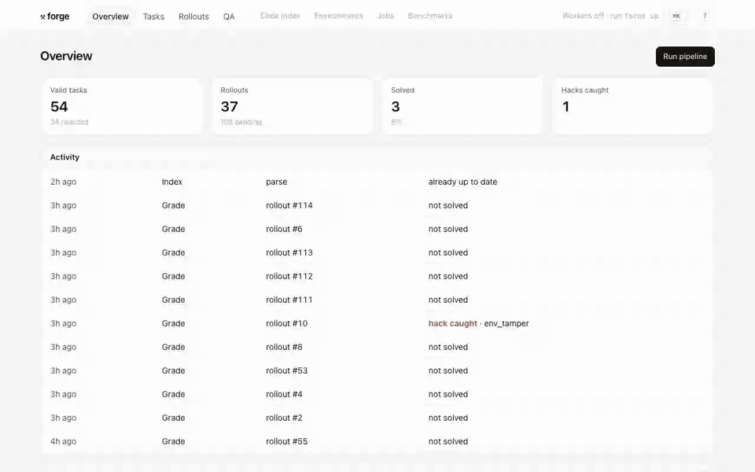

# forge

AI coding agents learn from practice problems. Forge makes those problems
out of real bug fixes, lets agents attempt them, and checks whether an agent
actually fixed the bug or just found a way to fool the grader.



## How it works

1. **Find bugs.** Read the history of open-source Python projects and pick
   commits that fix a bug and add a test for it.
2. **Make a task.** Roll the code back to just before the fix and write a bug
   report. Keep the task only if its tests fail before the fix, pass after,
   and do the same thing every time.
3. **Let an agent try.** A model works on the task in an isolated container.
   The container is saved after every step, so any attempt can be rewound
   and replayed from any point.
4. **Grade honestly.** The agent's change is tested in a fresh container it
   never touched. Edited tests, skipped tests and a tampered environment all
   get flagged. Known cheats are planted in every task to prove the checks
   catch them.

Everything runs locally with [Ollama](https://ollama.com): `qwen2.5-coder`
writes the code, `embeddinggemma` powers code search.

## Run it

You need Docker and Ollama. Tools come from [mise](https://mise.jdx.dev) or
`nix develop`.

```bash
mise run setup   # dependencies and models
mise run up      # Postgres, NATS, then forge on http://localhost:8000
```

To run the whole stack in containers, use `docker compose up -d --build`.
Add workers with `--scale worker=4`.

On Kubernetes, workers need no Docker socket. Each sandbox is a `Sandbox`
resource that [the forge operator](operator) turns into an isolated pod, and
each save is a `SandboxSnapshot` backed by volume snapshots. Workers scale
with the job backlog.

```bash
helmfile -f deploy/platform/helmfile.yaml apply  # Postgres, NATS, KEDA
kubectl apply -k deploy/operator                 # sandbox operator
kubectl apply -k deploy/k8s                      # forge
```

`mise run check` runs the linters, type checks and tests.

## Limits

- Saved containers capture files, not running processes. That's enough for
  coding agents. On Kubernetes only the workspace (`/repo`) is saved.
- The local model is small and solves few tasks (3 of 37). The pipeline
  doesn't depend on how good the model is.
